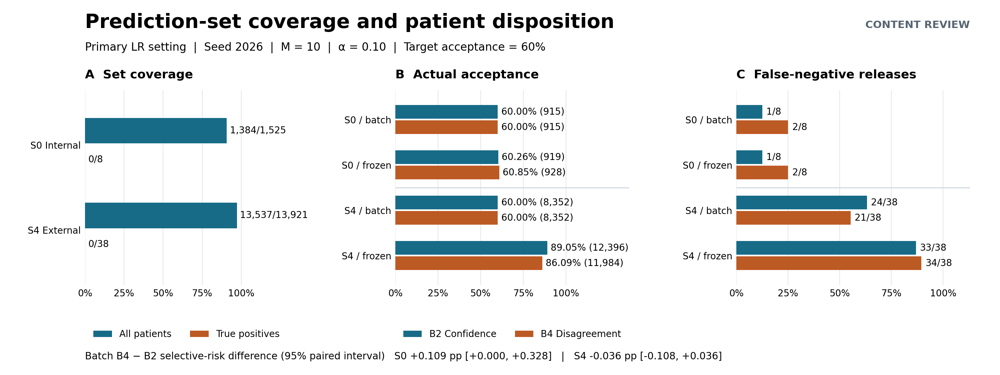

# Imputation Disagreement for Selective Prediction with Missing Clinical Data: A Two-Hospital Reliability Evaluation

**Review draft (2026-11-10).** C/E manuscript review and author statements are pending. Internal source IDs refer to the [number-to-source index](source_index.md).

**Authors:** [to be confirmed by the group]

---

## Abstract

**Background.** Multiple imputation produces a set of predictions for each patient with incomplete measurements. We evaluated whether disagreement across those predictions helps prioritize cases for automatic classification.

**Methods.** Using a retrospective two-hospital cohort from PhysioNet 2019, we predicted dataset-defined sepsis after ICU hour 12 through hour 24. We compared confidence and imputation disagreement using the same logistic-regression predictions and conformal singleton candidate pool. The primary outcome was the difference in error rate among accepted cases at a 60% target capacity. We also evaluated the acceptance thresholds selected in the source hospital on the held-out hospital.

**Results.** Among 24,095 included patients, 95 met the endpoint. At equal batch capacity, the selective-risk difference (disagreement minus confidence) was +0.109 percentage points internally (95% paired bootstrap interval [0.000, +0.328]) and −0.036 externally ([−0.108, +0.036]). External overall set coverage was 97.24%, while positive-class coverage was 0/38. Switching to disagreement deferred six external positives that confidence accepted as negative and converted three previously deferred positives to accepted negatives. With frozen thresholds, external acceptance reached 89.05% for confidence and 86.09% for disagreement, with 33/38 and 34/38 false-negative acceptances, respectively. Six rule-selection errors precluded estimation of the prespecified conditional increment.

**Conclusions.** Disagreement showed no stable selective-risk advantage in these cohorts. Reporting class-specific coverage, paired patient dispositions and realized acceptance exposed failure modes obscured by aggregate coverage. `[S-004, S-005, S-020, S-022–S-026]`

---

## 1 Introduction

Intensive care measurements are collected asynchronously and incompletely. A model that predicts deterioration from the first 12 hours therefore depends on how missing values are handled. Multiple imputation represents uncertainty about missing values rather than committing to one completed dataset, but its practical by-product is that predictions can vary across plausible completions. Two patients with the same mean predicted risk may differ in how sensitive that risk is to the completion.

Selective prediction offers a way to defer uncertain cases to human review. Conformal prediction provides distribution-free marginal coverage for prediction sets \cite{angelopoulos2023conformal}, and recent work connects conformal sets with cost-aware deferral in clinical triage \cite{kwon2026conformal}. Missing values complicate this pipeline: conformal prediction with missing values has been studied \cite{zaffran2023conformal}, conformal selection has been applied to clinical imputation with false-discovery-rate control \cite{he2026safeimpute}, and modality-conditional calibration has been proposed for missing-modality diagnosis \cite{wong2026mc2}. Uncertainty-aware sequence models for sparse healthcare time series use imputation and weighted evidential regression \cite{vavaroutas2025squiredl}.

These lines of work leave a practical question open. Confidence is the model’s self-assessment; missingness describes how much data are absent; imputation disagreement describes how much the prediction moves across plausible completions. A fair comparison must hold the predictor, imputation draws, conformal threshold, candidate pool and number of automatically accepted patients fixed. It must also report what happens when the singleton pool is smaller than the target capacity.

We evaluate three questions. First, how does overall prediction-set coverage relate to coverage and disposition among positive patients? Second, when the predictions, singleton pool and number accepted are held fixed, how does replacing confidence with imputation disagreement change selective risk and individual dispositions? Third, how much of the source-hospital acceptance capacity is retained when the same thresholds are applied at another hospital? Together, these comparisons trace the decisions from prediction sets to patient-level acceptance under both batch allocation and frozen rules.

---

## 2 Related Work

### 2.1 Conformal prediction and selective classification

Split conformal prediction constructs prediction sets with finite-sample marginal coverage under exchangeability \cite{angelopoulos2023conformal}. Clinical triage studies have combined conformal sets with cost-aware deferral and evaluated risk at fixed acceptance levels \cite{kwon2026conformal}. Li et al. pair patient dispositions to study release-side risk under prevalence shift. Their analysis uses distinct target-cohort subsets for prevalence correction, conformal calibration and evaluation \cite{li2026deployment}. Here the two rankings share the source model and singleton pool, and the external evaluation applies source thresholds without target-site recalibration.

### 2.2 Missing data and multiple imputation

Prior work studies conformal validity with imputed covariates, primarily for regression with an extension to classification \cite{zaffran2023conformal}. SafeImpute uses predictive dispersion under graph perturbations to score candidate imputed values and conformal selection to control the false discovery rate of released values under its stated assumptions \cite{he2026safeimpute}. Other work calibrates by available modality \cite{wong2026mc2}. Our unit of selection is a patient classification, and the disagreement score measures variation in that patient's predicted risk across variable-level imputations.

### 2.3 Uncertainty in sparse clinical time series

Evidential deep learning with spline-based imputation and weighted observed/imputed points has been proposed for sparse healthcare time series \cite{vavaroutas2025squiredl}. That line of work estimates uncertainty within a sequence model. Our design instead fixes a shared tabular predictor and measures disagreement across repeated imputations; the two signals are related but not interchangeable.

---

## 3 Methods

### 3.1 Cohort, labels and partitions

We use the PhysioNet/Computing in Cardiology Challenge 2019 data \cite{reyna2020early}. Eligible records contain ICU hours 1 through 24. Features use observations through hour 12. For records with an observed 0-to-1 label transition, we add six hours to the first positive label to recover the dataset-defined onset. We exclude patients with onset by hour 12 and records positive at the first observation, for which onset cannot be localized by the transition rule. The outcome is positive when the recovered onset falls after hour 12 and through hour 24.

Hospital A is split at the patient level into training (60%), rule selection (10%), calibration (15%) and internal test (15%), stratified by outcome. Training fits the imputer and classifier. Rule selection determines the model hyperparameter and acceptance cutoffs. The separate calibration partition determines the conformal quantile. Hospital B is held out entirely for external testing. We use seeds 2026–2030, with 2026 as the primary seed. `[S-020]`

### 3.2 Multiple imputation and shared predictor

We use the most recent observed value through hour 12 for each of 34 physiological and laboratory variables, along with age, sex as recorded by the dataset's Gender field, and a missingness indicator for each input. We fit a stochastic chained-equation imputer with Bayesian ridge conditional models on training inputs. We use ten iterations and M=10 completed versions. Imputed values are clipped to the range observed in training, and observed values are preserved. Variables entirely missing in training contribute their missingness indicators only.

A single logistic-regression classifier is trained on the M completed copies with weight 1/M per copy. The regularization parameter is selected from 0.1, 1 and 10 by average precision on the rule-selection partition, with ties resolved toward the smaller value. A random forest with 300 trees is used as a robustness check. For each patient, `p_mean` is the mean predicted positive probability across draws and `D` is the sample standard deviation (ddof=1); a flip indicates predictions on both sides of 0.5. Replicates are never treated as independent patients.

### 3.3 Conformal sets and capacity-constrained acceptance

The nonconformity score for candidate label `y` is `1 - p_mean(y)`. The split-conformal threshold at level `alpha = 0.10` is the `ceil((n+1)(1-alpha))`-th ordered calibration score; if the index exceeds the calibration size, the threshold is infinite. Empty and two-label sets are rejected; only singleton sets enter the automatic pool. Coverage is evaluated over all test patients, including empty sets.

At target acceptance `c` in {0.40, 0.60, 0.80}, batch allocation accepts `K = min(floor(cN), N_single)`, where `N` is the test size and `N_single` is the singleton-pool size. B2–B6 share the pool and `K` when available. Ties are broken by a fixed hash of patient identifiers. If the pool is smaller than the target, all its cases are accepted. For the frozen evaluation, we select cases at the target capacity in the rule-selection partition and retain the resulting score and hash cutoffs. At test time, each singleton is accepted by applying these cutoffs. The resulting acceptance rate can differ across methods and sites.

### 3.4 Comparators

| ID | Strategy | Ranking score |
|---|---|---|
| B0 | Training-median imputation + same classifier + independent conformal calibration | none (accept all singletons) |
| B1 | MI mean + conformal, accept all singletons | none |
| B2 | Confidence | `1 - max(p_mean, 1 - p_mean)` ascending |
| B3 | Missingness burden | fraction missing among the 34 physiological variables, ascending |
| B4 | Imputation disagreement | `D` ascending |
| B5 | Error-risk model | logistic regression on confidence and missingness, fitted on the rule-selection partition |
| B6 | Error-risk model with disagreement | B5 inputs plus `D` |

B5/B6 use all rule-selection patients, the base classification error at `p_mean >= 0.5` as the target, L2 logistic regression with C=1, and no additional tuning. If the rule-selection partition has fewer than 20 errors or fewer than 20 correct predictions, the model is unavailable and the conditional-increment conclusion is limited accordingly.

### 3.5 Metrics and uncertainty

Acceptance is the number accepted divided by all test patients. Selective risk is the number of accepted errors divided by the number accepted. Dangerous miss is the number of true positives that are accepted and predicted negative, divided by all true positives. Negative residual risk is the number of true positives among accepted negative predictions, divided by accepted negative predictions. Original-set coverage is the fraction of patients whose true label is in the original conformal set. Zero denominators are reported as NA with counts.

The primary contrast is B4 minus B2 selective risk at c=0.60, expressed in percentage points. B6 minus B5 is the prespecified conditional-increment contrast. We use percentile intervals from 1,000 patient-level paired bootstrap resamples. We recompute the ranking and capacity allocation in each batch-mode resample and retain the selected cutoffs for fixed-threshold resampling. The five seeds assess sensitivity to the source split and reuse the same external patients. We report coverage overall and by class, and trace positive cases from the initial prediction set to their paired acceptance outcomes.

### 3.6 Missingness stress tests and sensitivity analyses

S0 is natural missingness. S1 and S2 additionally hide 10% and 30% of originally observed physiological values at test time. S3 hides the laboratory block (official columns 9–34). S4 is the external hospital with natural missingness. Training and calibration remain at S0; the same patients and masks are shared across methods; indicators and missingness fractions are recomputed after hiding. Stress tests are not causal models of missingness mechanisms.

Sensitivity analyses include a random forest on S0/S2, M=5/10/20 on S0, alpha=0.05 on S0/S2, and five test-imputation batches for three-state decision stability. These are secondary and do not replace the primary contrast.

### 3.7 Reproducibility and evidence chain

Run manifests record the source, data and split hashes. The cohort audit replayed all 40,336 raw records to verify eligibility, endpoint assignment and feature extraction. An independently implemented technical check recomputed the derived coverage, paired dispositions and bootstrap intervals from the versioned results. The number-to-source index links the aggregate tables to their inputs and documents the scope of each check. `[S-020–S-026]`

---

## 4 Experimental Setup

The primary analysis uses seed 2026, logistic regression, M=10, the first test imputation batch and alpha=0.10. S0 is the internal test under natural missingness, and S4 is the held-out hospital under natural missingness. Both use the 60% target for the primary batch comparison and the corresponding cutoffs for the frozen-threshold evaluation. Results use data version `a-data-v1-20261104-r1` and main run `20261105T055420_02d05b15`. `[S-022, S-023]`

---

## 5 Results

### 5.1 Cohort and base-model discrimination

Table 1 summarizes cohort construction. The raw transition audit flagged 486 records with a label transition whose six-hour adjustment placed the inferred onset in the target window. Eligibility filters removed 391 of these records, including one whose inferred onset was beyond the released record. The final cohort contained 95 endpoint-positive patients. The main Hospital A split contained 34 training, 6 rule-selection, 9 calibration and 8 internal-test positives. `[S-020]`

**Table 1. Cohort and test-set counts.** Raw proxies are derived from observable label transitions before the eligibility filters.

| Hospital | Raw records | Raw target-window proxies | Included patients | Included positives | Test patients | Test positives |
|---|---:|---:|---:|---:|---:|---:|
| A | 20,336 | 334 | 10,174 | 57 | 1,525 | 8 |
| B | 20,000 | 152 | 13,921 | 38 | 13,921 | 38 |
| Total | 40,336 | 486 | 24,095 | 95 | — | — |

Logistic-regression AUROC was 0.793 internally (95% interval [0.579, 0.947]) and 0.502 externally ([0.407, 0.596]). External AUROC for the fixed random-forest diagnostic was 0.581 ([0.480, 0.674]). Both external estimates indicate limited discrimination in this evaluation, with substantial uncertainty. `[S-021]`

### 5.2 Prediction-set coverage and positive cases

Overall coverage was 1,384/1,525 (90.75%) internally and 13,537/13,921 (97.24%) externally. Positive-class coverage was 0/8 and 0/38, respectively. Four internal positives had empty sets, and four entered the candidate pool as negative singletons. All 38 external positives entered the pool as negative singletons. For these cases, the downstream ranking could defer the negative prediction or accept it as a false negative. `[S-022, S-025]`

**Figure 1. Prediction-set coverage and patient disposition.** Panel A reports marginal and positive-class coverage before acceptance. Panel B reports accepted cases as a fraction of all test cases under each allocation rule. Panel C reports accepted negative predictions among all positive cases. The 60.00% external batch acceptance is rounded from 8,352/13,921. [Vector figure](content-review/20261110-r1/fig_reliability.pdf). `[S-022, S-023]`

### 5.3 Equal-capacity ranking and paired dispositions

Internally, confidence and disagreement each accepted 915 patients. Confidence accepted 1/8 positives as negative, compared with 2/8 for disagreement. The difference in selective risk was +0.109 percentage points (95% paired bootstrap interval [0.000, +0.328]). Externally, each ranking accepted 8,352 patients, with 24/38 versus 21/38 false-negative acceptances. The corresponding difference was −0.036 percentage points ([−0.108, +0.036]). `[S-022, S-023]`

The external net reduction of three false-negative acceptances combined six patients moving from automatic negative classification to deferral and three moving in the opposite direction. Eighteen positives were accepted as negative by both rankings. Table 2 traces the same patients under both rules. The rule-selection partition contained six classification errors and 1,012 correct classifications. The error count fell below the minimum of 20 needed to fit B5 and B6, so the conditional-increment estimate is unavailable. `[S-004, S-024]`

**Table 2. Paired dispositions among positive cases at the 60% target.** A miss is an accepted negative prediction.

| Test cohort | Both miss | Confidence only misses | Disagreement only misses | Both defer | Positive cases |
|---|---:|---:|---:|---:|---:|
| Internal | 1 | 0 | 1 | 6 | 8 |
| External | 18 | 6 | 3 | 11 | 38 |

### 5.4 Acceptance under frozen thresholds

With source thresholds applied to the internal test, confidence accepted 919/1,525 patients (60.26%) and disagreement accepted 928/1,525 (60.85%). Applied externally, the same thresholds accepted 12,396/13,921 (89.05%) and 11,984/13,921 (86.09%), respectively. Confidence and disagreement accepted 33/38 and 34/38 external positives as negative. Across the five source splits, external acceptance ranged from 79.48% to 89.54% for confidence and 72.33% to 86.29% for disagreement. Each method therefore exceeded the 60% target on this held-out cohort across all source splits. `[S-022, S-026]`

### 5.5 Sensitivity and stability

The batch selective-risk difference changed sign across the source splits and scenarios. Across five seeds, its range was −0.109 to +0.109 percentage points internally and −0.048 to +0.012 externally. Under 30% additional masking (S2), the difference was zero for all five seeds. The prespecified random-forest, imputation-count and alpha checks are reported in Supplementary Tables S1–S3. Across pairs of test-imputation batches at the primary internal setting, mean batch-mode disposition disagreement was 4.79% for confidence and 17.18% for the imputation-disagreement ranking. `[S-005, S-008, S-010]`

---

## 6 Discussion

High overall external coverage coexisted with exclusion of the true label from every positive patient's prediction set. With positives comprising a small share of the test cohort, marginal coverage was driven by coverage among negatives. Standard split conformal coverage is a marginal property under exchangeability. The observed external coverage and the errors among accepted cases are empirical properties of the evaluated cohort and rules. `[S-022, S-025]`

The matched batch design identifies which patients changed dispositions at the same acceptance count. Both directions occurred externally, and the confidence and disagreement rankings had different point-estimate orderings across the two hospitals. The paired intervals include zero, so the direction and magnitude of a general advantage remain uncertain. The prespecified analysis of added information beyond confidence and missingness remains unestimated. Under frozen rules, both rankings accepted more patients externally than the target, with more false-negative acceptances than in the equal-capacity evaluation. A site evaluating such a rule would therefore need to track realized acceptance and class-specific errors alongside aggregate coverage. `[S-004, S-022–S-026]`

The small numbers of positive patients and the limited discrimination of both models externally restrict the inference to these cohorts. Eligibility required 24 hours of recorded follow-up, which selects a subset of ICU admissions. The endpoint uses the dataset's onset definition and a fixed label offset. The assessment reuses one retrospective dataset and the same held-out hospital across source splits. The artificial masks test sensitivity to measurement availability, and the imputations capture variability under the fitted procedure. The paired disposition summaries and random reference were added after inspection of the primary results. Evaluating clinical workflow impact would require prospective data and sufficient outcome events. `[S-020, S-021, S-024, S-027]`

---

## 7 Conclusion

Across these two hospitals, we observed no stable selective-risk advantage from replacing confidence with imputation disagreement at equal capacity. Class-specific coverage, paired dispositions and realized acceptance exposed different aspects of reliability. In particular, applying source thresholds externally increased acceptance despite persistent false-negative acceptances. `[S-022–S-026]`

---

## Statements

**Reproducibility.** Run manifests record inputs and SHA-256 hashes. The aggregate sources for the main figure and paired tables are indexed in the study repository.

**Data availability.** Source records are available from the [PhysioNet 2019 challenge dataset](https://physionet.org/content/challenge-2019/1.0.0/). The author group will confirm the final statement on access to derived artifacts.

**Ethics.** This study is a retrospective secondary analysis of publicly available records. [Institutional wording to be confirmed by the authors.]

**AI use disclosure.** [Authors to confirm the final wording and scope of AI assistance.]

**Author contributions.** A: data and labels; B: methods and experiments; C: literature and independent audit; D: figures and manuscript integration; E: coordination and integrity. The corresponding author is confirmed by the group.

---

## References

1. Kwon H, Kim D-J. Conformal selective prediction with cost aware deferral for safe clinical triage under distribution shift. Scientific Reports. 2026. doi:10.1038/s41598-026-40637-w.
2. Zaffran M, Dieuleveut A, Josse J, Romano Y. Conformal Prediction with Missing Values. ICML, PMLR 202; 2023.
3. He X, Ai M, Wang J, Cook CB, He J. SafeImpute: Reliable Clinical Data Imputation via Conformal Selection. KDD 2026. doi:10.1145/3770855.3817967.
4. Vavaroutas S, Dang T, Rocheteau E, Mascolo C. SQUIREDL: Sparse Sequence-to-Sequence Uncertainty Estimation in Evidential Deep Learning. ACM Transactions on Computing for Healthcare. 2025. doi:10.1145/3723049.
5. Wong KK, Ajit A. Guarantees That Survive a Missing Scan: Modality-Conditional Conformal Prediction for Multimodal Medical Diagnosis. MICCAI 2026 Satellite Events, LNCS 17272; 2026.
6. Reyna MA, Josef CS, Jeter R, Shashikumar SP, Westover MB, Nemati S, Clifford GD, Sharma A. Early Prediction of Sepsis From Clinical Data: The PhysioNet/Computing in Cardiology Challenge 2019. Critical Care Medicine. 2020;48(2):210–217. doi:10.1097/CCM.0000000000004145.
7. Angelopoulos AN, Bates S. Conformal Prediction: A Gentle Introduction. Foundations and Trends in Machine Learning. 2023. doi:10.1561/2200000101.
8. Li C, Liu X, Zhang H, et al. A Deployment Audit of Release-Side Risk in Conformal Triage under Prevalence Shift. arXiv preprint 2605.20956v2. 2026.

---

## Supplementary material for review

- Cohort stages, seed-2026 partition counts, and base-model diagnostic intervals are provided in the [aggregate source package](content-review/20261110-r1/claims_and_evidence.md). `[S-020, S-021]`
- [Per-seed stress tests](runs/20261105T055420_02d05b15/tables/table3_scenario_per_seed.csv) and [test-imputation stability](runs/20261105T055420_02d05b15/tables/table5_stability.csv) retain the natural and artificial missingness results. The [disagreement quintile diagnostic](runs/20261105T055420_02d05b15/tables/fig5_disagreement_data.csv) contains four errors among 1,388 internal singleton predictions. `[S-005, S-007, S-008]`
- Sensitivity tables from run `20261105T055445_54dd08de` include [S1, random forest](runs/20261105T055445_54dd08de/tables/table_s1_rf.csv), [S2, imputation count](runs/20261105T055445_54dd08de/tables/table_s2_m_sensitivity.csv), and [S3, alpha 0.05](runs/20261105T055445_54dd08de/tables/table_s3_alpha005.csv). `[S-010]`
- A post hoc [uniform random reference](content-review/20261110-r1/random_reference.csv) samples the same number of patients without replacement from the fixed singleton pool. Expected false-negative acceptances were 2.64 internally and 23.38 externally. Central 95% reference ranges were 1–4 and 17–29, respectively, under the fixed-pool sampling model. These ranges describe variability in allocation conditional on the observed pool. `[S-027]`
